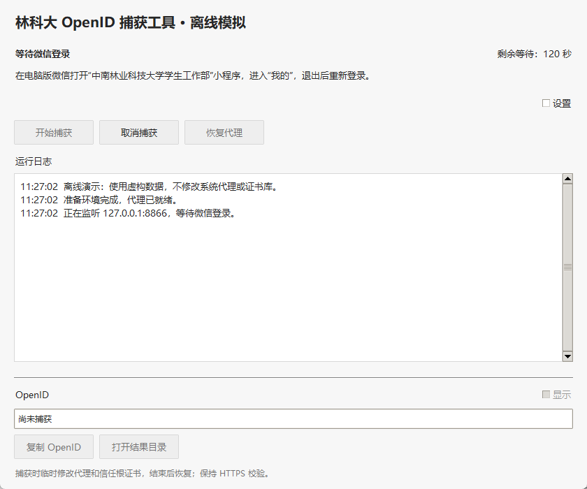
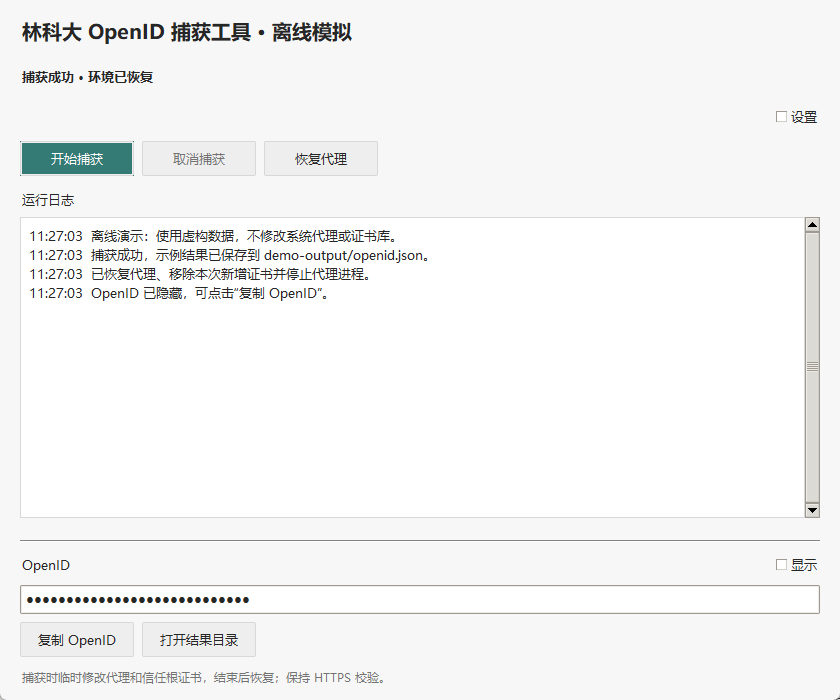

# 林科大 OpenID 捕获工具

独立的 Python / Tkinter 桌面工具，从本人在 CSUFT 微信小程序正常登录时的网络响应提取 OpenID。中文界面固定浅色，以黑白灰为主，仅主按钮少量使用青绿色。界面只保留操作、状态、日志和结果，登录指引在等待捕获时显示。只保存 OpenID，不执行签到。保留原命令行用法，与旁边的 `python-pingan-app` 独立运行。

当前版本 **1.0.0**。这是社区工具，并非学校、微信或小程序运营方的官方产品。本工程从 `csuft-pingan-daka` 中的独立 Python 工具继续开发；原作者、来源及许可证见 [NOTICE.md](NOTICE.md) 和 [LICENSE](LICENSE)。

[下载 Windows 便携包](https://github.com/Yzcat766/python-openid-tool/releases/latest) · [更新记录](CHANGELOG.md)

## 界面预览

以下截图使用离线虚构响应，OpenID 保持隐藏，日志使用示例目录；没有真实账号、捕获记录或私人路径。





## Windows EXE：解压即可运行

适用 Windows 10/11 x64。发行包内置 Python、Tk 和 mitmproxy 12.2.3，不需要另装 Python 或 Node.js。

1. 在 [GitHub Releases](https://github.com/Yzcat766/python-openid-tool/releases/latest) 下载 `python-openid-tool-windows-x64.zip`，解压到当前用户可写的本地目录。
2. 双击解压后的 `OpenIDTool/OpenIDTool.exe`。必须保留同目录 `_internal/` 和 `runtime/`，不能只复制单个 EXE。
3. 打开电脑版微信，点击“开始捕获”，工具自动检查环境并准备代理，等待状态显示“等待微信登录”。
4. 在微信打开 **“中南林业科技大学学生工作部”** 小程序，进入 **“我的”**，退出后重新登录。
5. 成功后点击“复制 OpenID”即可使用。结果默认隐藏，需要时勾选“显示”查看，或点击“打开结果目录”。

默认生成 EXE 所在目录下的 `output/openid.json` 与 `output/openid.txt`。下一次成功捕获会覆盖同名结果；可在高级设置更换输出目录。结果文件和剪贴板包含完整 OpenID，请自己保管。

打包版只需 **开始捕获 → 微信重新登录 → 复制结果**，无需手动安装或检查环境。端口 **8866**、超时 **120 秒** 已设置好；端口、超时、运行组件路径、上游代理与输出目录都收进默认折叠的“设置”。

EXE 已内置依赖，不显示“检查环境”和“安装依赖”入口。每次开始捕获时在后台自动检查运行组件、版本、端口和恢复记录；检查通过后才启动捕获，检查失败会给出具体处理方法。运行组件缺失时，请重新完整解压发行包，或在设置中指定可用的 mitmdump。自动检查本身不修改代理或证书库。

EXE 未签名；发布文件 SHA-256 位于 `releases/SHA256SUMS.txt`。工具本身不要求管理员权限，使用当前用户代理设置与当前用户根证书库。受组织证书策略限制时应联系管理员。

## 源码与双击入口

需要带 Tkinter 的 Python 3.12+。在源码目录双击 `start_gui.cmd`，或：

```powershell
python desktop.py
```

首次安装依赖可双击 `install.cmd`，或在工程目录运行以下命令；安装只创建本工程的 `.venv`，不会捕获微信数据或修改系统代理：

```powershell
python capture_openid.py install
.\.venv\Scripts\python.exe desktop.py
```

`start_gui.cmd` 优先使用本工程 `.venv` 的 `pythonw.exe`，其次使用已生成的发行 EXE，再尝试 PATH 中的 `pythonw`。源码 GUI 能在没有 mitmproxy 时启动，展开“高级设置”可使用“检查环境”和“安装依赖”；这两个入口只在非打包环境显示。依赖安装到本工程 `.venv`，也可双击 `install.cmd`。若当前 Python 发行版没有 Tkinter，需要安装带 Tcl/Tk 的 Python。

界面中的捕获、恢复、检查与依赖安装都在后台线程运行，队列与 `Tk.after` 更新界面。状态文字与日志展示任务运行情况，等待捕获时显示剩余时间，不显示进度条。安装日志实时展示创建环境、下载和安装信息。缺少 Python 3.12+ 时会提示安装 Python，或在高级设置中指定现有 `mitmdump.exe`。

源码模式的状态与默认输出位于源码目录；EXE 模式位于 EXE 目录。恢复时必须打开之前捕获使用的那份工具，不要混用不同目录的恢复记录。

## 设置与取消

- **监听端口**：1–65535，默认 8866；占用时更换端口。
- **超时**：有限的正数，默认 120 秒；计时从代理和证书就绪、进入等待状态时开始，代理启动另有 20 秒期限。
- **高级设置**：指定 mitmdump 路径、上游 HTTP/HTTPS 代理和输出目录。上游示例：`http://127.0.0.1:7890`。
- **取消捕获**：设置取消事件；捕获引擎在启动和等待阶段检查取消，然后进入原有 `finally` 清理。不会直接结束主程序。安装时此按钮也可取消后台安装。
- **关闭窗口**：后台任务进行中时请求取消并等待；代理恢复、证书清理与子进程停止完成后才退出。恢复任务本身会完成后再退出。
- **清理失败**：保留恢复记录；关闭请求暂缓，窗口留下具体错误，请先点击“恢复代理”重试。

捕获期间禁用再次启动、安装、恢复以及配置输入，避免相互干扰。不同实例的捕获、恢复和安装通过原有 Windows 命名互斥机制协调；源码 CLI 和 EXE 使用同一互斥名称。

## 代理、证书与隐私

捕获期间会临时修改当前用户系统代理并信任工具根证书。**始终保持 HTTPS 证书校验**，不设置 `ssl_insecure`，不使用跳过证书验证的安装选项。

在修改设置之前，工具保存 `.state/restore.json`，记录代理开关、地址、绕过名单、PAC、自动检测及注册表值是否原本存在。捕获期间暂停 PAC 和自动检测，监听地址仅为 `127.0.0.1`。

根证书来自独立 `.state/ca/`。只有目标主机参与 HTTPS 解密，其它主机通过 `allow_hosts` 放行。`addon.py` 仅从目标主机与准确路径的成功响应中提取非空 `data` 字符串；JSON 只保存 OpenID、去掉查询参数的接口地址和捕获时间，不保存 jsCode、请求头或完整响应。

成功、失败、超时和取消都走同一清理流程：恢复原代理、移除本次新增的信任根证书、停止本次代理子进程并删除临时结果。原本已信任的证书不移除；CA 文件在本地保留以供下次使用，不能随发行包分发。恢复进程前校验 PID、启动时间和可执行路径，防止 PID 被复用时误终止其它进程。

运行日志和 CLI 不打印完整 OpenID、jsCode、响应或私钥；完整 OpenID 只用于结果显示、复制与 JSON/TXT 保存。为了避免代理异常输出夹带敏感请求，`.state/mitmdump.log` 不保存代理原始输出。启动失败通过界面的退出码与修复建议排查。

## 异常结束后的恢复

强制结束进程、断电或强制关闭终端可能跳过 `finally`。重新打开原目录中的 GUI，检测到 `.state/restore.json` 时会明确提示，禁用“开始捕获”；点击“恢复代理”。不会自动覆盖旧备份。

源码也可双击 `restore.cmd`，或运行：

```powershell
python capture_openid.py restore
# 自定义状态目录时须使用捕获时的同一目录
python capture_openid.py restore --state-dir D:\path\to\state
```

恢复失败时记录继续保留，修复问题后重试。不要删除未恢复的 `.state/`，不要与网页中的 OpenID 捕获同时运行。EXE 模式没有 Python 也能使用“恢复代理”。

## 排错

| 现象 | 可执行的处理方法 |
| --- | --- |
| 缺少 mitmdump | 源码模式在高级设置点击“安装依赖”；EXE 发行包应带 `runtime/mitmdump/`，请重新完整解压；也可在高级设置指定现有程序 |
| 依赖安装失败 | 查看日志末尾错误；确认 Python 3.12+、网络和目录权限；使用下面的 HTTPS pip 源命令重试，不关闭 TLS 校验 |
| 端口已占用 | 停止其它捕获程序，或展开设置把端口改为 8867，再点击“开始捕获” |
| 另一实例正在运行 | 先取消另一窗口或 CLI 的捕获，等待它清理完成 |
| 发现遗留恢复记录 | 先点击“恢复代理”；不要删除备份或换目录掩盖问题 |
| 代理启动失败 / 提前退出 | 检查设置中的程序路径、端口和上游配置；EXE 重新完整解压发行包，源码可在高级设置检查环境或安装依赖 |
| 捕获超时 | 必须在“等待微信登录”后退出小程序并重新登录；确认电脑版微信使用系统代理；可增加超时。微信忽略代理或接口变化时可能无法捕获 |
| 捕获期间网络不通 | 原网络需要代理时，在高级设置配置原上游代理；取消捕获恢复原设置后检查连通性 |
| 访问被拒绝 / 清理失败 | 解压到自己可写的目录；检查组织代理或证书策略；保留备份，修复权限后再点“恢复代理” |
| 窗口正在关闭 | 等待后台清理完成；若出现清理失败，窗口会保留供恢复重试 |

```powershell
python capture_openid.py install --index-url https://pypi.tuna.tsinghua.edu.cn/simple
```

## 保留的命令行

原命令与参数仍可使用，Ctrl+C 协作取消，完整 OpenID 改为仅保存到结果文件：

```powershell
python capture_openid.py doctor
python capture_openid.py capture
python capture_openid.py capture --timeout 300 --port 8867
python capture_openid.py capture --env-file output\accounts.env
python capture_openid.py capture --upstream http://127.0.0.1:7890
python capture_openid.py capture --mitmdump C:\path\to\mitmdump.exe
python capture_openid.py capture --upstream-ca C:\path\to\trusted-ca.pem
python capture_openid.py restore
```

`--env-file` 仅在明确指定时追加账号，不覆盖其它账号。将结果导入 `python-pingan-app` 时，在该软件中点击“导入 OpenID 文件”，选择 JSON、TXT 或 ENV 即可。

CLI 保留 `--target-host`、`--target-path`、`--manual-proxy`、`--skip-cert-install`、`--state-dir` 和 `--output` 等参数。手动代理与跳过证书模式由使用者配置和恢复设置；常规 GUI 使用自动模式。

## 离线验证与窗口检查

本次开发只使用模拟响应与本机 HTTP/HTTPS 服务，未执行真实微信捕获，未读写真实代理配置，未安装或移除真实系统根证书。

```powershell
# 全部单元和本地接口集成测试
.\.venv\Scripts\python.exe -m unittest discover -s tests -v

# 离线 GUI，可手动操作所有按钮
python desktop.py --demo
python desktop.py --demo --demo-outcome timeout --demo-delay 3
python desktop.py --demo --demo-outcome error

# 自动跑真实窗口事件循环：成功、隐藏、窗口缩放、超时、错误、关闭取消
python desktop.py --demo --verify-demo --demo-dir verification\source-demo
.\releases\OpenIDTool\OpenIDTool.exe --demo --verify-demo --demo-dir verification\exe-demo

# 实际窗口截图，需要 Pillow；保存到 verification/
.\.venv\Scripts\python.exe tests\verify_windows.py
.\.venv\Scripts\python.exe tests\verify_windows.py --packaged

# 使用已打包的代理组件重复本地 HTTP/HTTPS、超时和强制结束恢复测试
.\.venv\Scripts\python.exe tests\verify_packaged_proxy.py

# 检查 ZIP 隐私与哈希，清空 Python PATH 后启动原 EXE 和中文路径中的解压包
.\.venv\Scripts\python.exe tests\verify_release.py
```

`--demo` 使用同一捕获引擎和 addon，替换代理进程、注册表和证书库接口，只操作隔离的 `.demo-state/` 与 `demo-output/`，不会进入真实系统设置。`--verify-demo` 必须与 `--demo` 一起使用，报告保存到指定目录的 `verification-report.json`。

36 项测试覆盖原有解析、账号追加、HTTP/HTTPS 捕获和恢复，并新增状态顺序、剩余时间、日志隐私、启动与等待取消、恢复失败保留记录、互斥、安装进度/错误/取消、CLI 兼容、恢复目录保护、窗口关闭和窗口缩放，以及源码诊断入口、EXE 简化布局、自动检查失败和检查中取消。集成测试只在单次本地 HTTPS 连接中信任临时 CA，不改系统证书库。实际窗口检查覆盖 720×640、展开设置的 720×790 和 1080×1000；日志区域随窗口伸缩并可滚动。

## 构建 Windows 发行包

在 Windows x64 上用 Python 3.12+ 构建，双击 `build_windows.cmd`，或：

```powershell
python capture_openid.py install
.\.venv\Scripts\python.exe -m pip install -r requirements-build.txt
.\.venv\Scripts\python.exe build_windows.py
```

固定 mitmproxy 12.2.3 和 PyInstaller 6.19.0，构建依赖中的 Pillow 用于窗口截图。桌面 EXE 使用 windowed 模式；代理组件是独立控制台 EXE，由主程序以隐藏窗口启动，避免代理运行在 UI 线程。构建记录 `BUILD-INFO.json` 包含 Python 和依赖版本。

输出：

- `releases/OpenIDTool/OpenIDTool.exe`：直接可运行的桌面 EXE。
- `releases/python-openid-tool-windows-x64.zip`：完整便携发行包。
- `releases/python-openid-tool-source.zip`：源码、入口、构建脚本、测试与说明。
- `releases/SHA256SUMS.txt`：发行 ZIP 的 SHA-256。

发行 ZIP 使用过滤和源码白名单，不包含 `.venv`、捕获结果、恢复记录、验证目录或证书私钥。构建只写本工程 `build/` 与 `releases/`。

## 文件与捕获接口

| 文件 | 用途 |
| --- | --- |
| `desktop.py` / `start_gui.cmd` | 中文 GUI 与双击入口 |
| `desktop_service.py` | 后台线程、队列、取消与互斥 |
| `capture_openid.py` | 复用的捕获/安装/恢复引擎与 CLI；状态回调和取消事件 |
| `addon.py` / `core.py` | 响应钩子、OpenID 解析、原子保存与可选 ENV 追加 |
| `windows_proxy.py` | 当前用户代理、证书、互斥和进程身份校验 |
| `runtime_paths.py` | 源码 / EXE 的资源与数据目录 |
| `offline_demo.py` / `demo_verify.py` | 隔离模拟接口与真实 UI 循环验证 |
| `mitmdump_entry.py` / `build_windows.py` | 内置代理入口与发行构建 |
| `tests/` | 原有测试及桌面生命周期与视觉验证 |
| `docs/screenshots/` | 使用虚构数据的公开截图 |
| `VERSION` / `CHANGELOG.md` | 当前版本与更新说明 |
| `NOTICE.md` / `LICENSE` | 原作者归属与许可证 |

目标接口为 `https://simp.csuft.edu.cn/api/flySource-base/openApi/getOpenidByJsCode`，从成功 JSON 响应的非空字符串 `data` 中读取 OpenID。引擎 `capture(args, status_callback=None, cancel_event=None)` 回调传递 `stage`、`message` 与可选 `remaining`，只在清理完成后返回结果；取消抛出 `CaptureCancelled`。调用捕获和恢复需持有现有 `exclusive_capture()`；GUI 与 CLI 均已这样处理。

保留 MIT 许可证及原版权声明，具体来源见 [NOTICE.md](NOTICE.md)。参考：[mitmproxy 插件文档](https://docs.mitmproxy.org/stable/addons/overview/)、[mitmproxy 证书文档](https://docs.mitmproxy.org/stable/concepts/certificates/)。
